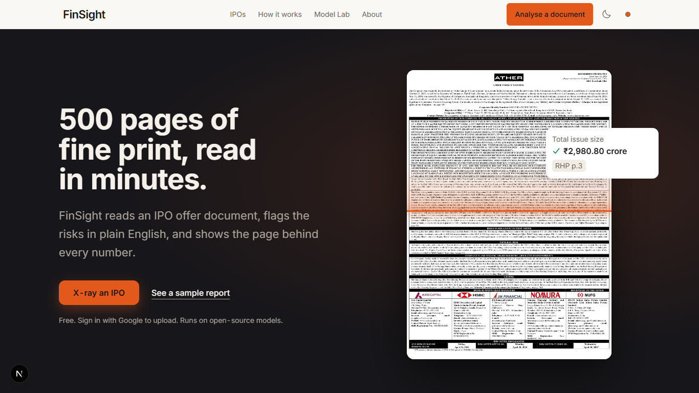
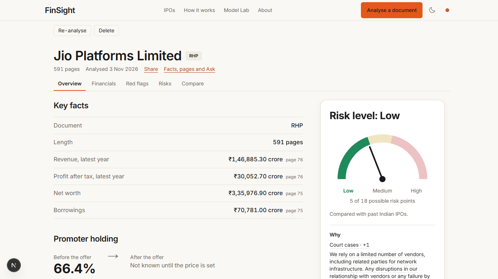
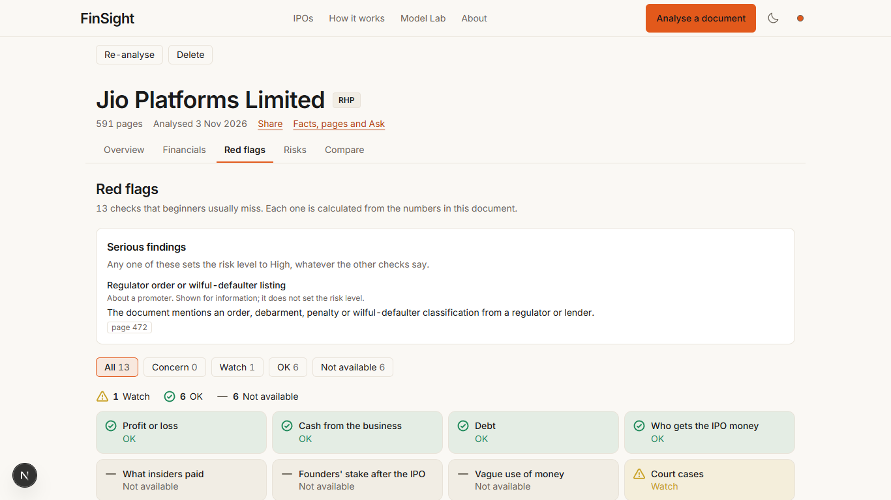
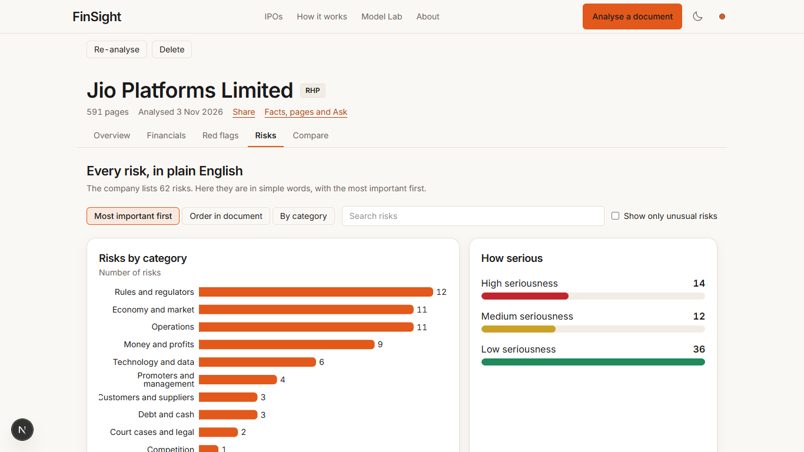
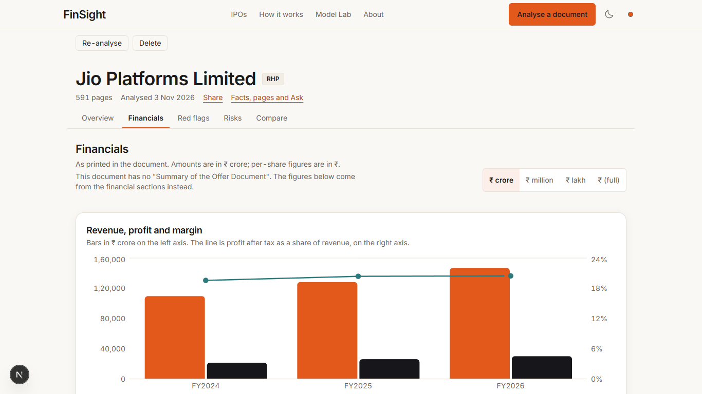
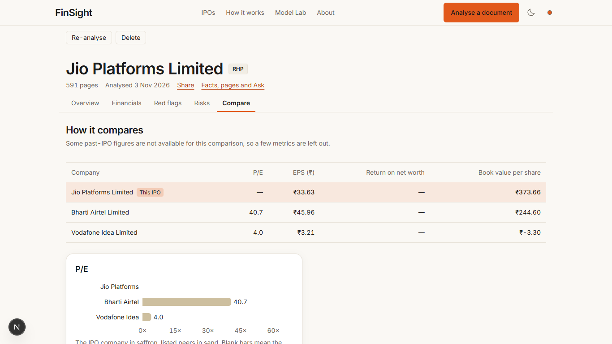
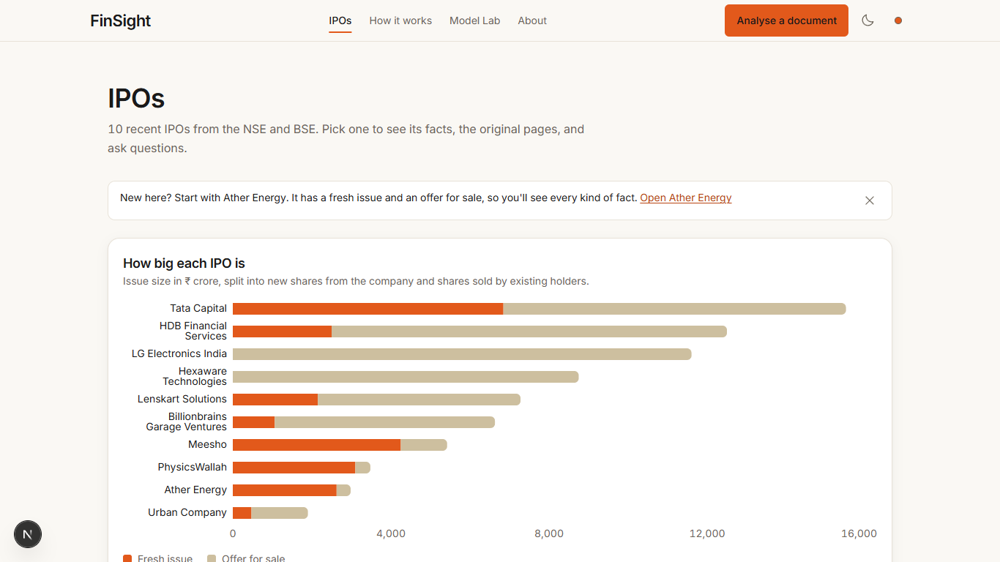
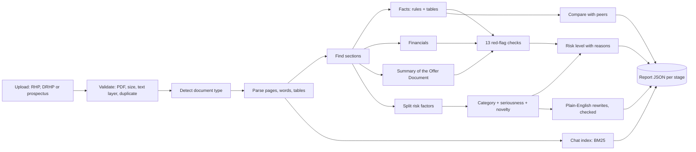
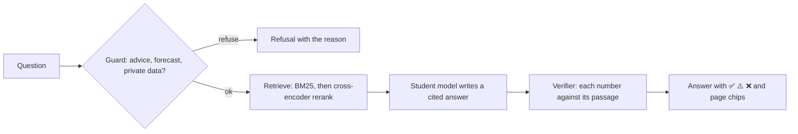

# Vidura — IPO X-Ray for Indian retail investors

Formerly Vidura.

[](https://github.com/AkshatTm/Vidura-IPO-X-Ray/actions/workflows/backend.yml)
[](https://github.com/AkshatTm/Vidura-IPO-X-Ray/actions/workflows/frontend.yml)
[](https://github.com/AkshatTm/Vidura-IPO-X-Ray/actions/workflows/docs.yml)
[](LICENSE)


**Vidura reads an Indian IPO offer document (RHP, DRHP or prospectus) on your own computer and gives back a report you can check: key facts with the page they came from, 13 red-flag checks, every risk factor rewritten in plain English, a risk level with its reasons, comparisons with listed peers, and a chat whose numbers are marked ✅ verified, ⚠️ unverifiable or ❌ contradicted against the document.** Every model is open-weight and runs locally; nothing is sent to a server.

Vidura was the Mahabharata minister who saw danger early and said it plainly, even when the court did not want to hear it. Vidura does the same for an IPO offer document: it surfaces the facts and red flags, but never tells you whether to apply.

> **Not investment advice.** Vidura summarises what a public filing discloses. It never says whether to apply, buy or sell, and never predicts a price or listing gain. The risk level describes the document, always with its reasons and a disclaimer; it is not a rating.



**Documentation:** [docs site](docs/index.md) · [install](docs/getting-started/install.md) · [run](docs/getting-started/run.md) · [read a report](docs/user-guide/reading-results.md) · [API guide](docs/reference/api-guide.md) · [FAQ](docs/faq.md)

## The problem

A Red Herring Prospectus runs to hundreds of pages; the Jio Platforms RHP used in the timings below has 591. The facts a retail investor needs, such as the issue price band, the promoter's holding before and after, litigation totals, related-party transactions and the risk factors, are spread across it and written in legal language. Vidura finds them, shows the page each one came from, and is honest about what it could not find.

## Features

| | |
| --- | --- |
|  | **Report overview.** Risk level (Low / Medium / High) with the checks and risks behind it and its disclaimer; the company's own summary of the offer (SOD), price band, issue size, promoter holding before and after. |
|  | **Red flags.** 13 rule-based checks (OK, Watch, Concern, not available, not applicable), each with the figure, the threshold and the page. Serious findings (regulator orders, fraud, wilful defaulter) are labelled by whom they concern; only those about the issuer force High ([C-ADR-26](docs/phase3/C_DECISIONS.md)). |
|  | **Risk factors.** Every numbered risk factor is split out, given a category by a fine-tuned classifier, marked as usual or rare against 29,677 risks from 440 past IPOs, and rewritten in plain English by a fine-tuned 4B model, with its numbers and hedges checked against the original. |
|  | **Financials.** Three fiscal years and the stub period: revenue, profit after tax, EPS, NAV per share, PAT margin, debt to equity, return on net worth, with a unit switch. |
|  | **Compare.** The listed peers from the basis-for-offer-price table, side by side with the issuer, and a reference from past IPOs. |
|  | **Library and upload.** Ten pre-analysed showcase IPOs and your own uploads. A stored report is reused only if the PDF hash, the pipeline version (4.2) and the models are unchanged; **Re-analyse** and **Delete** are on every report. |

The chat answers from the document only, cites its pages, refuses advice and forecast questions before any model runs, and checks every number in the answer against the passage it cites. The number check uses no model: it normalises lakh, crore and million and compares values.

## Results

Generated from `eval_results/` by [`scripts/readme_results.py`](scripts/readme_results.py); the full list, including what was not re-run, is the [final scorecard](eval_results/final/FINAL_SCORECARD.md). **Re-measured** means run again for v1.1 on pipeline 4.2 (3 Nov 2026); **carried** means the last Phase 3 measurement, not re-run. Test-slice documents were scored, never tuned on ([C-ADR-02](docs/phase3/C_DECISIONS.md)).

<!-- results:start -->
| What | Metric | Result | Status | File |
| --- | --- | --- | --- | --- |
| Key facts from the offer document (E14) | value match, 10 showcase IPOs, gold v3 | **0.774** (195 rows) | re-measured, v1.1 | [`final/e14_today.json`](https://github.com/AkshatTm/Vidura-IPO-X-Ray/blob/main/eval_results/final/e14_today.json) |
| Red-flag statuses (E15) | accuracy, 13 checks × 10 IPOs | **0.769** (130 statuses) | re-measured, v1.1 | [`final/e15_today.json`](https://github.com/AkshatTm/Vidura-IPO-X-Ray/blob/main/eval_results/final/e15_today.json) |
| Risk category classifier (DeBERTa-v3-base) | dev macro-F1, 3 seeds (TF-IDF 0.862) | **0.892 ± 0.006**; gold-150 0.899 | carried | [`b/classifier_base.json`](https://github.com/AkshatTm/Vidura-IPO-X-Ray/blob/main/eval_results/b/classifier_base.json) |
| Plain-English rewrites, faithful (gold-50, blind human rating) | base / student / teacher | 0.84 / **0.92** / 0.98 | carried, one seed | [`c/simplify_gold50.json`](https://github.com/AkshatTm/Vidura-IPO-X-Ray/blob/main/eval_results/c/simplify_gold50.json) |
| Plain-English rewrites, readability 1–5 (gold-50) | base / student / teacher | 3.00 / **4.64** / 4.80 | carried, one seed | [`c/simplify_gold50.json`](https://github.com/AkshatTm/Vidura-IPO-X-Ray/blob/main/eval_results/c/simplify_gold50.json) |
| Rewrites passing the product post-checks (gold-50) | student vs base | **49 / 50** vs 16 / 50 | carried, one seed | [`c/student_vs_base_gold50.json`](https://github.com/AkshatTm/Vidura-IPO-X-Ray/blob/main/eval_results/c/student_vs_base_gold50.json) |
| Vidura Bench v1, task A key facts (rules) | value match [95 % CI], 7 test IPOs | 0.724 [0.636, 0.816] | carried, single run | [`c4/bench_summary.json`](https://github.com/AkshatTm/Vidura-IPO-X-Ray/blob/main/eval_results/c4/bench_summary.json) |
| Vidura Bench v1, task B red flags (rules) | status accuracy [95 % CI] | 0.703 [0.582, 0.824] | carried, single run | [`c4/bench_summary.json`](https://github.com/AkshatTm/Vidura-IPO-X-Ray/blob/main/eval_results/c4/bench_summary.json) |
<!-- results:end -->

Caveats the sources state:

- The showcase gold sets are small (10 IPOs for E14 and E15, 7 test IPOs for the bench) and AI-prefilled, then checked by one person (`label_source` in each file). Eight of the ten showcase IPOs are test-slice documents.
- The plain-English scores are one seed and one blind rater; the classifier's training labels come from a teacher model ([teacher datasheet](docs/phase2/datasheets/teacher_outputs.md)).
- On the bench, the rules beat the fine-tuned student on key facts and red flags, and the student answered more questions but abstained less and refused fewer advice probes. In the product the guard refuses advice before the model runs ([evaluation](docs/evaluation.md)).
- The scorecard's corpus table labels the recent universe "2021–2026"; the dates in `configs/ipo_universe.csv` are 2024–2026 ([correction note](docs/evaluation.md)).

**Speed** (Jio Platforms RHP, 591 pages, RTX 2050 4 GB, 16 GB RAM, from the scorecard): **264 s** from upload to a finished report, most of it in risk scoring and the chat index.

## How it works





The upload pipeline runs 14 stages in a background job and streams progress to the browser by server-sent events; each stage writes its JSON to `data/store/docs/<doc_id>/`, so a failed job resumes. A model that is missing makes the job stop before it starts, with an "Analyse without it" option, and a report made without a model is marked degraded and never cached as complete. Details: [architecture](docs/architecture/index.md), [pipeline](docs/architecture/pipeline.md), [jobs](docs/architecture/jobs.md).

## Tech stack

| Layer | Used |
| --- | --- |
| Backend | Python 3.11, uv, FastAPI + sse-starlette, pydantic v2, SQLAlchemy Core + Alembic, SQLite (Postgres optional) |
| Documents | PyMuPDF, pdfplumber, rule-based section and table readers |
| Models at run time | Ollama (GGUF), ONNX Runtime, PyTorch + transformers, sentence-transformers, bm25s |
| Training (not on the laptop) | Kaggle notebooks through the official CLI, Colab jobs exchanged through a Hugging Face dataset ([training lanes](docs/operations/training-lanes.md)) |
| Frontend | Next.js App Router, TypeScript strict, Tailwind, shadcn/ui, Motion, TanStack Query, Zustand, Recharts, MSW, openapi-typescript |
| Quality | pytest + Hypothesis, ruff, mypy, Vitest, Playwright, MkDocs Material (strict), markdownlint, a link checker, GitHub Actions |

## Models

| Model | Job in v1.1 | Base | Card |
| --- | --- | --- | --- |
| `finsight-student:q4` | plain-English rewrites and chat answers | Qwen3-4B-Instruct-2507, LoRA, GGUF Q4_K_M | [risk_simplifier](docs/model_cards/risk_simplifier.md) |
| Risk category classifier | category of each risk factor | DeBERTa-v3-base, ONNX fp32, seed 42 | [risk_classifier](docs/model_cards/risk_classifier.md) |
| Reranker | orders chat passages | BAAI/bge-reranker-v2-m3 (not fine-tuned) | [reranker](docs/model_cards/reranker.md) |
| Novelty embeddings | usual or rare against past IPOs | BAAI/bge-m3 (not fine-tuned) | [risk_classifier](docs/model_cards/risk_classifier.md) |
| Field extractor (QA) | offline showcase fact sheets only; uploads use rules + tables | deepset/deberta-v3-base-squad2 | [extractor_qa](docs/model_cards/extractor_qa.md) |
| Guard classifier | trained, **not shipped**; the keyword guard is used | google/muril-base-cased | [guard_muril](docs/model_cards/guard_muril.md) |
| BiLSTM-CRF tagger | Phase 1 comparison, not in the product | trained from scratch | [bilstm_crf](docs/model_cards/bilstm_crf.md) |

Licences of every base model and dataset: [NOTICE](NOTICE). The weights are not in this repository; [install](docs/getting-started/install.md) says where each one comes from and which are not published.

## Quickstart (Windows)

Needs [uv](https://docs.astral.sh/uv/), [pnpm](https://pnpm.io) with Node 24, [Ollama](https://ollama.com) and the model files described in [install](docs/getting-started/install.md).

```bat
git clone https://github.com/AkshatTm/Vidura-IPO-X-Ray.git
cd Vidura-IPO-X-Ray
start.bat
```

Choose **[1] Start everything**. The launcher starts Ollama, the API on port 8000 and the web app on port 3000 in minimised windows, waits for `/api/health`, and opens <http://localhost:3000>. `start.bat status` shows what runs; `stop.bat` stops only Vidura. The first run installs the Python and Node packages. What each step does: [Run Vidura](docs/getting-started/run.md).

### Manual setup (any OS)

```bash
uv sync --inexact --group ml --group onnx    # Python packages incl. the model groups
cd frontend && pnpm install && cd ..
ollama serve                                  # in its own terminal
VIDURA_PROFILE=local uv run poe api         # API on :8000
cd frontend && pnpm dev                       # web app on :3000
```

Frontend work without a backend: `cd frontend && NEXT_PUBLIC_USE_MOCKS=1 pnpm dev` (synthetic data). Checks: `uv run poe test`, `uv run poe lint`, `uv run poe typecheck`, `cd frontend && pnpm test`.

### Hardware

Built and timed on Windows 11, 16 GB RAM and an NVIDIA RTX 2050 with 4 GB. The reranker runs in fp16 on the GPU when there is one and on the CPU otherwise. The student GGUF is 2.5 GB. Close other GPU programs before a long analysis. Problems: [troubleshooting](docs/getting-started/troubleshooting.md).

## Project layout

```text
src/vidura/      the Python package: one folder per job
  api/               FastAPI app and routes
  jobs/              background job runner, stages, cache key
  storage/ db/       files under data/store, SQLite / Postgres
  ingest/ parse/     PDF checks, pages, words, tables, sections
  extract/ summary/  fact extractors and the SOD engine
  redflags/ risks/ risklevel/ compare/   the report
  retrieve/ generate/ verify/ guard/ chat/   the chat
  normalize/         Indian number formats (lakh, crore)
  weaklabel/ evaluate/ bench/ splits/   training data, scoring, Vidura Bench
frontend/          Next.js web app (mocks in frontend/mocks)
configs/           every setting as YAML (reference: docs/reference/configs.md)
eval_results/      result files; final/FINAL_SCORECARD.md
bench/v1/          Vidura Bench v1, frozen
data/gold/         hand-checked gold sets; data/manifests/ split manifests
notebooks/         Kaggle and Colab training notebooks
scripts/           evaluation, docs generation, preload, link check
docs/              the documentation site (MkDocs); docs/archive/ for stale pages
tests/             pytest tests, one folder per package
start.bat stop.bat the Windows launcher
```

## Limitations

- The gold sets are small and AI-prefilled, then checked by one person; read the intervals in the result files, not only the point scores.
- Red flags come from rules. When a figure is not in the document (four checks need the price band, which a DRHP does not have) the check says "not available" instead of guessing.
- The chat comes from a 4B local model and can be wrong. The verifier marks numbers, not reasoning.
- The past-IPO comparison describes the 440 IPOs in the risk bank, not the market. The "riskier than X % of past IPOs" figure is hidden because it tracked document length ([C-ADR-28](docs/phase3/C_DECISIONS.md)).
- English only. Scanned PDFs without a text layer are refused.
- One local user and no authentication: do not expose ports 8000 or 3000 ([SECURITY](SECURITY.md)).

## Roadmap and what was cut

Vidura v1.1 is the final version of a course project. Phase 4 planned new models (M1–M5), a second benchmark (Platform Bench) and gold v4; they were cut so the product could keep the measured Phase 3 models, and the time went into the SOD engine, the Financials tab, cache v2, a fairer risk level and the launcher. Hindi chat and voice input were removed on 3 Nov 2026 to keep one well-tested path. The full account, with reasons: [project history](docs/history.md) and the [changelog](CHANGELOG.md).

Ideas that are not planned work: OCR for scanned filings, red-flag checks for DRHPs that lack a price band, and a person-checked gold set beyond ten IPOs.

## Contributing

Issues and pull requests are welcome; read [CONTRIBUTING](CONTRIBUTING.md) first. Also: [Code of conduct](CODE_OF_CONDUCT.md) · [Security](SECURITY.md) · [Privacy](PRIVACY.md) · [Changelog](CHANGELOG.md) · [Decisions](docs/adr/index.md).

## Licence

Code: MIT ([LICENSE](LICENSE)). The weak-label corpus of Ghosh et al. (`sohomghosh/Indian_IPO_datasets`) is CC BY-NC-SA 4.0, so models trained with it are non-commercial and are not released as public models. RHPs and prospectuses are public SEBI and exchange filings and are not redistributed here. Third-party models keep their own licences ([NOTICE](NOTICE)).

## Acknowledgements

- Sohom Ghosh and co-authors for the Indian IPO datasets.
- The Qwen, DeBERTa, BGE and MuRIL teams for open-weight models, and Google for the Gemma teacher model.
- Kaggle and Google Colab for the GPU time used for training ([compute log](eval_results/c/compute_log.jsonl)).
- Built for CSE472 (Deep Learning for NLP), with AI coding assistants; AI-assisted labels are marked with their `label_source`.

## Citation

If you use Vidura, cite it with [CITATION.cff](CITATION.cff) (GitHub shows a "Cite this repository" button):

```bibtex
@software{tomar_finsight_2026,
  author  = {Tomar, Akshat},
  title   = {Vidura: IPO X-Ray for Indian retail investors},
  version = {1.1},
  year    = {2026},
  url     = {https://github.com/AkshatTm/Vidura-IPO-X-Ray}
}
```
