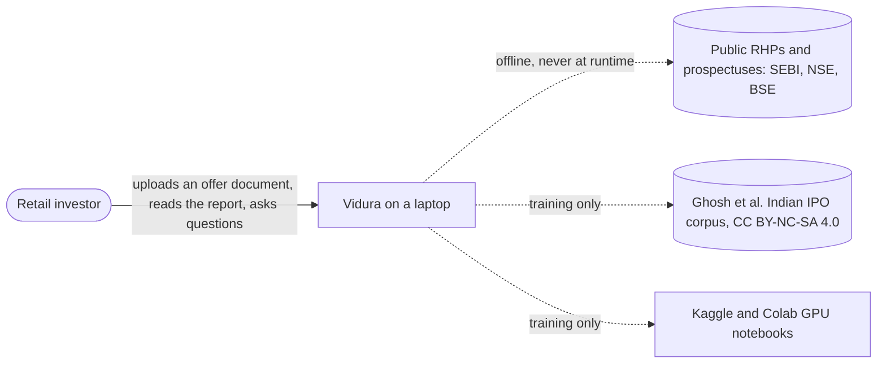
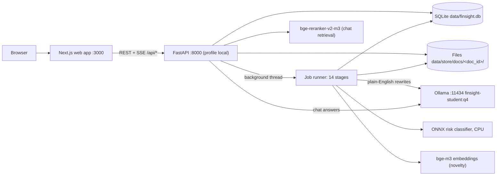
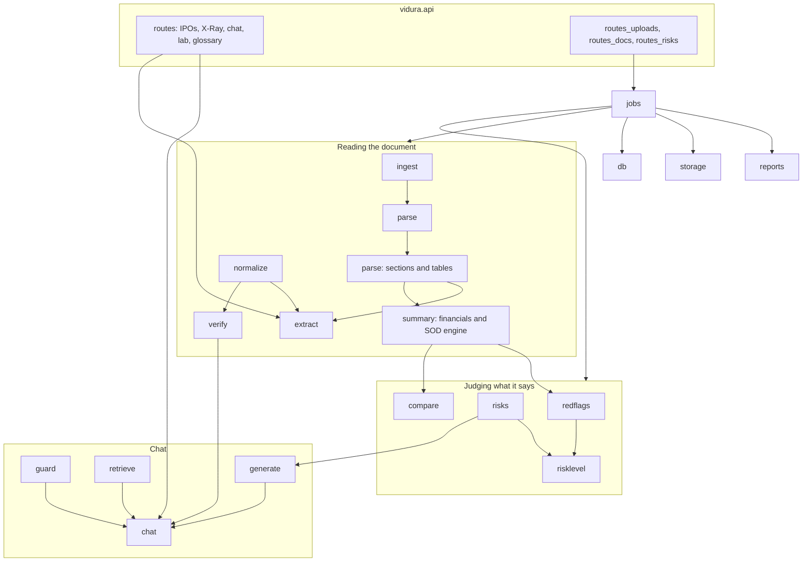
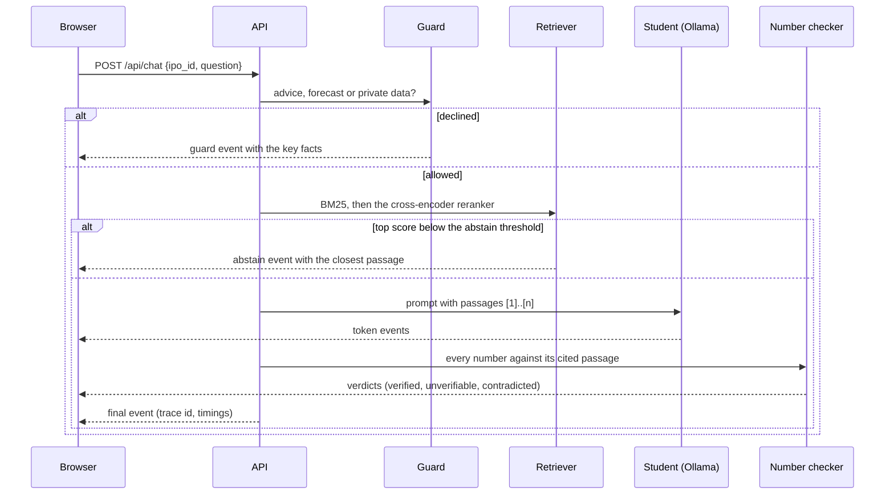
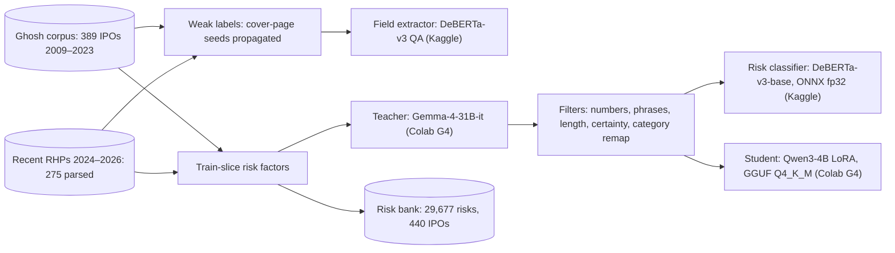

# System overview

Vidura is one Python process (FastAPI API plus an in-process job runner), a Next.js web app and
Ollama, all on one laptop. Documents and results are local files and a SQLite database. This page shows
the system at three levels (context, containers, components) and the two main flows. Each stage is
detailed on [Pipeline stages](pipeline.md); the reasons are in the [decision records](../adr/index.md).

## Context



No hosted LLM API is called at runtime (ADR-002, B-ADR-06); every model is open-weight. Nothing is
hosted: the Google Cloud design was removed (B-ADR-16) and deployment was cut with Phase 4.

## Containers



| Container | Code | How it starts |
| --- | --- | --- |
| Web app | `frontend/` (Next.js App Router) | `pnpm dev --port 3000` from `start.bat` |
| API + job runner | `vidura.api`, `vidura.jobs` | `uvicorn vidura.api.app:app --port 8000` from `start.bat` |
| Model server | Ollama | `ollama serve` from `start.bat` |
| Jobs by hand | `python -m vidura.jobs run \| simplify \| forget \| sweep` | command line, same stages without the API |

Supabase sign-in and Postgres still exist in code (`vidura.auth`, `VIDURA_DB__URL`) but are off:
without Supabase settings every request is one local user ([Settings](../reference/config.md)).

## Components



Each package lives in `src/vidura/<package>/` and is imported only through its `__init__.py`; its
docstring states its job ([Python packages](../reference/python.md)). The packages by job:

| Package | Job |
| --- | --- |
| `core` | Schemas, settings, logging and IDs shared by every package |
| `ingest` | Showcase registry, corpus builder, upload checks (`validate_pdf`) |
| `parse` | PDF to words, boxes and page images (PyMuPDF), sections and tables |
| `normalize` | Indian number formats: lakh, crore, million, `[●]` placeholders, periods |
| `extract` | Field extractors (rules first, fine-tuned QA as cross-check) and the X-Ray fact sheet |
| `summary` | Financial summary and the Summary of the Offer Document (SOD) engine |
| `redflags` | 13 rule-based checks and serious findings with their subject |
| `risks` | Risk factors: split, classify (ONNX), novelty (bge-m3), hedging, seriousness |
| `risklevel` | Points, share of points possible, Low / Medium / High, overrides |
| `compare` | Listed peers from the document and the past-IPO reference |
| `reports` | Assemble `report.json` from the stage outputs |
| `retrieve`, `generate`, `guard`, `verify`, `chat` | Chat: BM25 + reranker, the student, the advice guard, the number checker |
| `jobs`, `storage`, `db`, `auth` | Job runner and cache, files, database, the local user |
| `evaluate`, `bench`, `weaklabel`, `splits`, `handoff` | Evaluation, Vidura Bench, weak labels, time split, Phase 4 hand-off pack |

## Upload sequence

```mermaid
sequenceDiagram
  participant U as Browser
  participant A as API
  participant S as data/store
  participant D as SQLite
  participant W as Job runner
  U->>U: SHA-256 of the file
  U->>A: POST /api/uploads/init {filename, size_bytes, sha256}
  A->>D: doc_id = "doc_" + first 16 hex of the hash
  alt same file, current pipeline version
    A-->>U: {status: "exists", doc_id}
  else new or stale
    A->>D: size and daily-quota checks
    A-->>U: {status: "upload", doc_id, upload_url}
    U->>A: POST /api/uploads/{doc_id}/file (the PDF)
    A->>S: source.pdf
    U->>A: POST /api/uploads/{doc_id}/complete {analyse_without?}
    A->>A: model preflight (503 models_unavailable unless skipped)
    A->>S: re-hash (422 hash_mismatch if it differs)
    A->>W: start the job on a background thread
    A-->>U: {doc_id, job_id, status: "queued"}
    U->>A: GET /api/docs/{doc_id}/events (SSE, resumable)
    loop each stage
      W->>S: stage output (parsed.json, redflags.json, ...)
      W->>D: stage, progress and ready events
      A-->>U: events
    end
    W->>D: done; analysis_status complete / degraded / failed
    U->>A: GET /api/docs/{doc_id}/report
  end
```

## Chat sequence



## Training data flow



Training never runs on the laptop ([training lanes](../operations/training-lanes.md)). Labels written by
a model carry `label_source`; test-slice and bench IPOs never enter training (C-ADR-02,
[Data](../data/index.md)).
