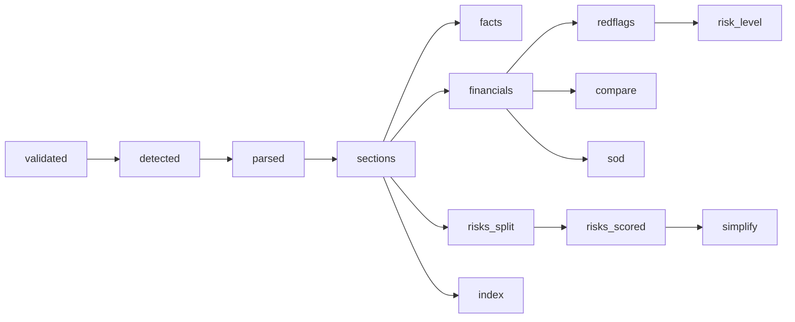

# Pipeline stages

An upload runs 14 stages in order, after the `received` event. They are defined in
`src/finsight/jobs/pipeline.py` (`upload_stages`) and `src/finsight/jobs/model_stages.py`
(`model_stages`), and run by the [job runner](jobs.md). Every output is written to
`data/store/docs/<doc_id>/`.



| Stage | Needs | What it does | Writes | Models |
| --- | --- | --- | --- | --- |
| `validated` (critical) | — | Text PDF? size ≤ 50 MB, ≤ 1,500 pages, not encrypted, an offer document. Refusal codes: `too_large`, `too_many_pages`, `scanned`, `password`, `not_offer_document` | — | — |
| `detected` (critical) | validated | Document type (RHP, DRHP, prospectus), page count, company | `doc.json` | — |
| `parsed` (critical) | detected | Every page's words and boxes (PyMuPDF) | `parsed.json` | — |
| `sections` | parsed | Finds the chapters (Risk Factors, Summary of the Offer Document, Basis for Offer Price, …) from the table of contents and headings | `sections.json` | — |
| `facts` | sections | The X-Ray fact sheet: issue size, fresh issue, OFS, price band, … by rules, each with page and box | `xray.json` | — |
| `financials` | sections | Three fiscal years + stub, read from the page geometry (C-ADR-16), and the other red-flag inputs (C-ADR-17) | `summary.json` | — |
| `redflags` | financials | 13 checks and the serious findings, each with its subject (issuer, promoter, director, group company; C-ADR-26) | `redflags.json` | — |
| `compare` | financials | Listed peers from Basis for Offer Price; the issuer row named after the company | `compare.json` | — |
| `sod` | financials | Summary of the Offer Document engine: financial rows, ratios, strengths, promoter holding pre/post, price band; chapter stand-ins when there is no summary (C-ADR-27) | `sod.json` | — |
| `risks_split` | sections | Splits Risk Factors into numbered risks | `risks.json` | — |
| `risks_scored` | risks_split | Category, seriousness band, novelty against the risk bank, hedging and numbers | `risks.json` (updated), `risks_scored.json` | ONNX classifier; `bge-m3` |
| `risk_level` | redflags | Points, share of points possible, level, overrides (issuer only), reasons | `risklevel.json` | — |
| `simplify` | risks_scored | Queues the `simplify.auto_top_n` (15) most important risks; a worker rewrites them one at a time and announces each with a `risk_simplified` event | `simplified.json` | `finsight-student:q4` (Ollama) |
| `index` | sections | Copies parsed pages and sections to `data/processed/<doc_id>/` and builds the chat's BM25 index | `index.json` marker, `data/processed/<doc_id>/` | — |

`report.json` is not a stage: `finsight.reports` assembles it from whatever outputs exist when the report
is requested, so a report opens before the last stage finishes.

## Timings

One upload of the 591-page Jio Platforms RHP on the reference laptop, seconds from upload to the end of
each stage (single run, from `data/preload_log.csv`, summarised in
[FINAL_SCORECARD](https://github.com/AkshatTm/FinSight-IPO-X-Ray-for-Indian-retail-investors/blob/main/eval_results/final/FINAL_SCORECARD.md#laptop-timings-rtx-2050-4-gb-16-gb-ram-profile-local)):

| validated | parsed | sections | facts | financials | red flags | compare | sod | risks split | risks scored | risk level | simplify | index |
| --- | --- | --- | --- | --- | --- | --- | --- | --- | --- | --- | --- | --- |
| 6 | 23 | 23 | 25 | 29 | 32 | 32 | 33 | 46 | 148 | 149 | 149 | 258 |

Total 264 s including the upload.

## Cache key and pipeline version

A stored analysis is valid for

```text
sha256(pdf)  +  pipeline_version  +  models_fingerprint
```

(`src/finsight/jobs/cache.py`, CC-04 "cache v2").

- **`sha256(pdf)`** is the document id: `doc_id = "doc_" + the first 16 hex characters`.
- **`pipeline_version`** is set in `configs/config.yaml` and is **4.2** at v1.1 (C-ADR-26 issuer-only
  overrides and C-ADR-28 hidden percentile changed stored output). Bump it whenever extraction,
  red-flag or risk-level logic changes.
- **`models_fingerprint`** hashes the Ollama tag with its digest, the ONNX classifier, the reranker file
  and the `bge-m3` snapshot. Weight files are hashed once and remembered by size and modification time
  in `data/cache/weight_hashes.json`.

Opening a report whose version or fingerprint differs re-runs it ("This report was made with an older
version of FinSight"). A **degraded** analysis (a stage failed, or a model was skipped) is never cached
as complete. If a needed model is down when a stale report is opened, the report says the newer
analysis "can't run right now" and offers **Analyse without it**.

## The offline pipeline (showcase IPOs)

The 10 showcase IPOs in the library are built with the older offline command, which has its own stage
names:

```bash
uv run python -m finsight.pipeline build --ipo <ipo_id> --stage parse   # then sections, tables, rules, qa, xray, index
uv run python -m finsight.pipeline inspect --ipo <ipo_id> --stats
```

`scripts/build_showcase.py` builds their upload-style reports, and `scripts/preload.py` re-analyses a
list of documents through the API ([Operations](../operations/index.md)).
