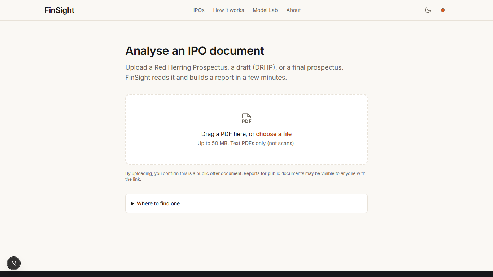

# Your first upload

With FinSight running ([Run FinSight](run.md)), open <http://localhost:3000> and click
**Analyse a document**.

## 1. Pick a document

FinSight reads Indian IPO offer documents: a **Red Herring Prospectus (RHP)**, a **draft (DRHP)** or a
**final prospectus**, as a **text PDF** up to 50 MB and 1,500 pages. SEBI's website and the NSE / BSE
issue pages publish them. A scanned PDF has no text layer and is refused; OCR is not built.

## 2. Upload

Drop the PDF or choose it. The browser computes the file's SHA-256 first. If the same file was analysed
before with the current pipeline version, you go straight to its report. Otherwise:

1. **Model check.** FinSight checks that the models it needs are available: the student in Ollama, the
   ONNX risk classifier, the `bge-m3` embeddings and the reranker. If one is missing you can still
   continue with **Analyse without it**; the report then says which part is incomplete.
2. **Analysing.** The page lists each stage as it finishes (validated, parsed, sections, facts,
   financials, red flags, compare, summary of the offer document, risks split, risks scored, risk
   level, plain-English rewrites, search index). The full list with the files each stage writes is in
   [Pipeline stages](../architecture/pipeline.md).
3. **See what's ready** opens the report while the rest continues.

For the 591-page Jio Platforms RHP the whole run took 264 s on the reference laptop; the slow parts are
risk scoring (about 100 s) and the search index (about 110 s)
([timings](https://github.com/AkshatTm/FinSight-IPO-X-Ray-for-Indian-retail-investors/blob/main/eval_results/final/FINAL_SCORECARD.md#laptop-timings-rtx-2050-4-gb-16-gb-ram-profile-local)).

## 3. Read the report

The report has five tabs (Overview, Financials, Red flags, Risks, Compare) and a link to **Facts, pages
and Ask**, the workspace with the PDF pages and the chat. [Pages and tabs](../user-guide/index.md)
explains each one and [Reading the results](../user-guide/reading-results.md) explains the risk level,
the red-flag statuses and the page citations.

## 4. Re-analyse or delete

The two buttons at the top of every report:

- **Re-analyse** runs the whole pipeline again on the stored PDF (after a confirmation). Reports made by
  an older pipeline version are re-analysed automatically when you open them.
- **Delete** removes the report, its page images and its search index. Upload the file again to start
  from scratch.

The same actions exist in the API (`POST /api/docs/{doc_id}/reanalyse`, `DELETE /api/docs/{doc_id}`,
see the [API guide](../reference/api-guide.md)) and on the command line
(`uv run python -m finsight.jobs forget <doc_id>`).

## Where the results live

Everything stays on your machine: the PDF and every stage's output in `data/store/docs/<doc_id>/`, the
document and job rows in the SQLite file `data/finsight.db`. See
[Storage and database](../architecture/storage.md) and [PRIVACY](https://github.com/AkshatTm/FinSight-IPO-X-Ray-for-Indian-retail-investors/blob/main/PRIVACY.md).
