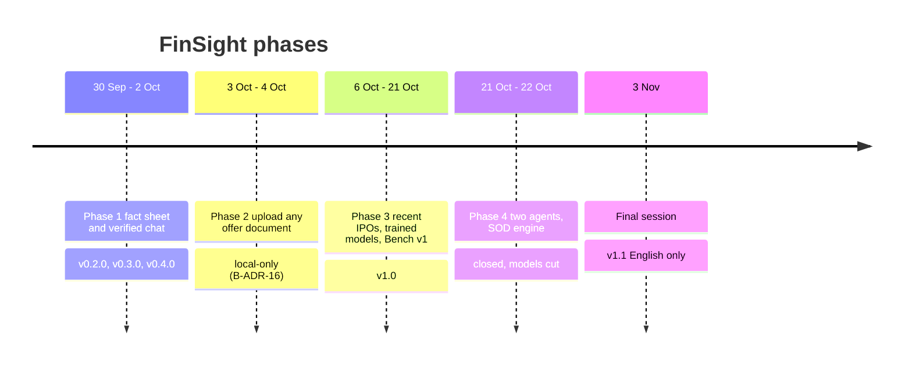

# Project history

FinSight was the course project for CSE472 (Deep Learning for NLP), built between 30 Sep and 3 Nov 2026
by Akshat Tomar with AI coding agents (Claude Code throughout; Gemini 4 Argon as a second agent in
Phase 4). Each phase had its own planning documents. They are kept on GitHub exactly as written, with a
"historical record" banner, so plans that changed or were cut can still be read.

## Phase 1: IPO X-Ray and verified chat (v0.2.0 – v0.4.0)

**Delivered.** Parsing with word boxes, Indian number normalisation, the extractor ladder (rules,
pretrained QA, fine-tuned QA trained on weak labels, BiLSTM-CRF), the X-Ray fact sheet with page
citations, BM25 + dense + rerank retrieval, cited chat from a local LLM, the ✅ / ⚠️ / ❌ number verifier,
the advice guard, the FastAPI service and the full web UI (library, workspace, Model Lab). Chat and UI
were bilingual (English and Hindi) with voice input.

**Key numbers** ([evaluation](evaluation.md#phase-1-results-fact-sheet-and-chat)): fine-tuned QA test
NVM 0.74 vs rules 0.86 on the full document and 0.85 vs 0.23 when the cover is hidden; chat numbers
verified 0.69 of 86 on test (one run).

**Planning records:** [00_README](https://github.com/AkshatTm/FinSight-IPO-X-Ray-for-Indian-retail-investors/blob/main/docs/00_README.md),
[PRD](https://github.com/AkshatTm/FinSight-IPO-X-Ray-for-Indian-retail-investors/blob/main/docs/01_PRD.md),
[architecture](https://github.com/AkshatTm/FinSight-IPO-X-Ray-for-Indian-retail-investors/blob/main/docs/02_ARCHITECTURE.md),
[roadmap](https://github.com/AkshatTm/FinSight-IPO-X-Ray-for-Indian-retail-investors/blob/main/docs/07_ROADMAP.md),
[gates](https://github.com/AkshatTm/FinSight-IPO-X-Ray-for-Indian-retail-investors/tree/main/docs/gates).

## Phase 2: upload any offer document

**Delivered.** Uploads (validation, duplicate check by hash, quotas, retention), storage and database
layers, the job runner with resumable server-sent events, red flags (13 checks), risk-factor features
(novelty, hedging, numbers), the risk level with reasons and disclaimer, Compare, the report page,
teacher / classifier / simplifier code and notebooks, and this docs site.

**Changed course.** The Google Cloud hosting design (B-ADR-04) was removed after one day: the product
became local-only (B-ADR-16).

**Planning records:** [B00 index](https://github.com/AkshatTm/FinSight-IPO-X-Ray-for-Indian-retail-investors/blob/main/docs/phase2/B00_README.md),
[execution plan](https://github.com/AkshatTm/FinSight-IPO-X-Ray-for-Indian-retail-investors/blob/main/docs/phase2/B_EXECUTION_PLAN.md).

## Phase 3: recent IPOs, trained models, FinSight Bench (v1.0)

**Delivered.** 289 recent RHPs collected and 275 parsed; the frozen time split (C-ADR-02); the risk
bank (29,677 risks); the teacher chosen by a blind bake-off (Gemma-4-31B-it); the DeBERTa-v3-base risk
classifier (dev macro-F1 0.892 ± 0.006, 3 seeds); the Qwen3-4B student (gold-50 faithful 0.92, post-checks
49 / 50); extractor v2 and DeBERTa-v3-large and the 8B student as reported ablations; gold v3 / v3.1,
gold-150 and gold-50; fitted risk-level thresholds (C-ADR-25); FinSight Bench v1; E14 0.769 and E15
0.762 after the reader fixes.

**Cut.** Frontier answers for the bench, the outcome comparison (E21), hosting (C5.1).

**Planning records:** [C00 index](https://github.com/AkshatTm/FinSight-IPO-X-Ray-for-Indian-retail-investors/blob/main/docs/phase3/C00_README.md),
[roadmap](https://github.com/AkshatTm/FinSight-IPO-X-Ray-for-Indian-retail-investors/blob/main/docs/phase3/C05_ROADMAP.md),
[execution plan](https://github.com/AkshatTm/FinSight-IPO-X-Ray-for-Indian-retail-investors/blob/main/docs/phase3/C_EXECUTION_PLAN.md).

## Phase 4 (closed)

**Plan.** "Beat the brokers": two agents in parallel. Claude Code (CC) on the product: cache v2,
the Summary-of-Offer (SOD) engine, Financials, red flags v2 and risk level v2, Platform Bench and
integration. Gemini 4 Argon (ARGON) on models and labels: M1 student v2, M2 salience ranker, M3 event
classifier, M4 severity v2, M5 evaluation, gold v4, SOD fixtures, event labels.

**Delivered.** CC-01 (v1.0 freeze), CC-02 (hand-off pack in `ml/handoff/`), CC-04 (cache v2:
preflight, versioned cache key, degraded status, delete + re-analyse), CC-05 / CC-06 (SOD engine with
chapter stand-ins, Financials, strengths, promoter holding; decided red-flag checks over 289 RHPs
1,561 → 1,714; Jio 7 / 13 decided). From ARGON: the L2 event labels (1,007 AI-labelled sentences) and
notebooks for M1 and M3.

**Cut, and why.** No model was trained (0.12 Colab units used), so M1–M5 and their integration
(CC-09) were dropped and the product kept the Phase 3 models. Platform Bench (CC-03, CC-10) and gold v4
were dropped: the hand-collected platform data and the gold were not ready when Phase 4 closed. Red flags v2 / risk
level v2 (CC-07) were replaced by two targeted fixes in the final session (C-ADR-26, C-ADR-28).
Supabase sign-in and the cloud deployment, planned for the week after, were not done.

**Planning records:** [P4 plan](https://github.com/AkshatTm/FinSight-IPO-X-Ray-for-Indian-retail-investors/blob/main/docs/phase4/P4_PLAN.md),
[CC progress](https://github.com/AkshatTm/FinSight-IPO-X-Ray-for-Indian-retail-investors/blob/main/docs/phase4/PROGRESS_CC.md),
[ARGON progress](https://github.com/AkshatTm/FinSight-IPO-X-Ray-for-Indian-retail-investors/blob/main/docs/phase4/PROGRESS_ARGON.md).

## Final session (v1.1)

**Delivered.** `sod` in the report; C-ADR-26 (only events about the issuer force High; Jio High →
Low); C-ADR-28 (the percentile hidden because it tracked document length); Compare names the issuer;
`pipeline_version` 4.2; Hindi and voice removed (English-only API; old clients still work);
blank and outdated analyses purged with a backup; `scripts/preload.py`; the "Charcoal & Saffron"
redesign; `start.bat` / `stop.bat`; the [v1.1 scorecard](evaluation.md#v11-scorecard) with E14 0.774 and
E15 0.769 re-measured.

**Why English only.** To keep one well-tested path (FINAL_SCORECARD, item 7): Hindi output had been
checked by one reviewer only, and speech input needed its own dependency group (`asr`), now removed.

**Rules for the session:** [final/RULES.md](https://github.com/AkshatTm/FinSight-IPO-X-Ray-for-Indian-retail-investors/blob/main/docs/final/RULES.md),
[final/CONTRACT.md](https://github.com/AkshatTm/FinSight-IPO-X-Ray-for-Indian-retail-investors/blob/main/docs/final/CONTRACT.md).

## Records kept from every phase

- [Decisions](adr/index.md): 55 ADRs, 16 B-ADRs, 28 C-ADRs.
- [CHANGELOG](https://github.com/AkshatTm/FinSight-IPO-X-Ray-for-Indian-retail-investors/blob/main/CHANGELOG.md) and git tags `v0.2.0`, `v0.3.0`, `v0.4.0`, `v1.0`, `v1.1-pre`, `v1.1`.
- [PROGRESS.md](https://github.com/AkshatTm/FinSight-IPO-X-Ray-for-Indian-retail-investors/blob/main/PROGRESS.md)
  and the per-phase progress logs.
- [The documentation audit](https://github.com/AkshatTm/FinSight-IPO-X-Ray-for-Indian-retail-investors/blob/main/docs/archive/DOCS_AUDIT.md)
  and the archived pages in `docs/archive/`.
- The B3.5a [security review](https://github.com/AkshatTm/FinSight-IPO-X-Ray-for-Indian-retail-investors/blob/main/docs/security_review.md).
