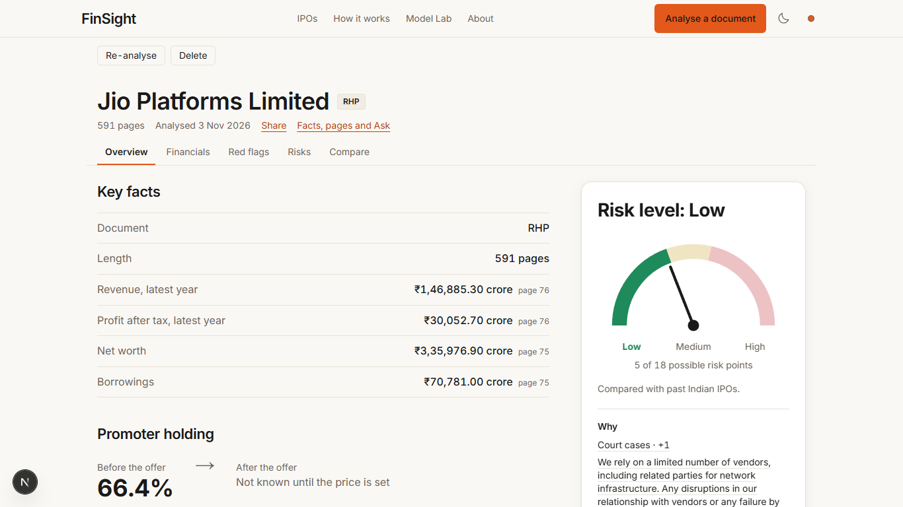

# FinSight

**IPO X-Ray for Indian retail investors.** Upload an Indian IPO offer document (RHP, DRHP or final
prospectus) and FinSight reads all of it on your own laptop (264 s for the 591-page Jio Platforms RHP
on an RTX 2050 laptop, [one run](https://github.com/AkshatTm/FinSight-IPO-X-Ray-for-Indian-retail-investors/blob/main/eval_results/final/FINAL_SCORECARD.md#laptop-timings-rtx-2050-4-gb-16-gb-ram-profile-local)). It gives you:

- **key facts and financials**, every figure with the page it was read from;
- **13 red-flag checks** on the numbers the document discloses;
- a **risk level** (Low / Medium / High) with its reasons and a disclaimer;
- **every risk factor in plain English**, most important first;
- a **comparison** with the listed peers the document names;
- a **chat** that answers from the document and marks each number ✅ verified, ⚠️ unverifiable or
  ❌ contradicted.

FinSight explains what a document says. It never tells you to apply, buy, sell or avoid, and it does
not predict prices. All models are open-weight and run locally; no paid LLM API is called.

## Where to start

| You want to… | Read |
| --- | --- |
| Install and run it | [Install](getting-started/install.md), then [Run FinSight](getting-started/run.md) |
| Understand a report | [Pages and tabs](user-guide/index.md), [Reading the results](user-guide/reading-results.md) |
| See how it works inside | [System overview](architecture/index.md), [Pipeline stages](architecture/pipeline.md) |
| Check the numbers | [Results and experiments](evaluation.md), [Model cards](model_cards/index.md) |
| Call the API | [API guide with curl](reference/api-guide.md) |
| Change a setting | [Settings](reference/config.md), [Configuration files](reference/configs.md) |
| Contribute | [Developer guide](development/index.md) |
| Know why something is the way it is | [Decisions](adr/index.md), [Project history](history.md) |

## Status

Version **1.1** (pipeline version 4.2), English only. The project is finished: Phase 4 model training,
the Platform Bench and cloud hosting were cut ([history](history.md)). Every number on this site comes
from a file in `eval_results/` and says whether it was re-measured for v1.1 or carried from an earlier
run; the summary is
[FINAL_SCORECARD.md](https://github.com/AkshatTm/FinSight-IPO-X-Ray-for-Indian-retail-investors/blob/main/eval_results/final/FINAL_SCORECARD.md).

!!! warning "Not investment advice"
    FinSight summarises public disclosures. The risk level describes how much risk the document
    discloses compared with past Indian IPOs; it is not a rating and does not say whether to invest.
