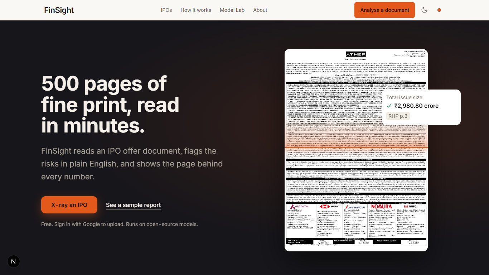
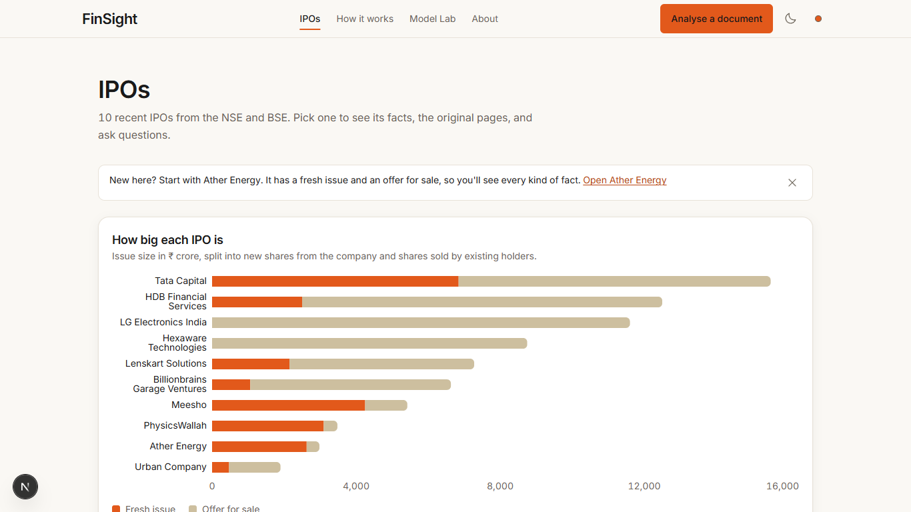
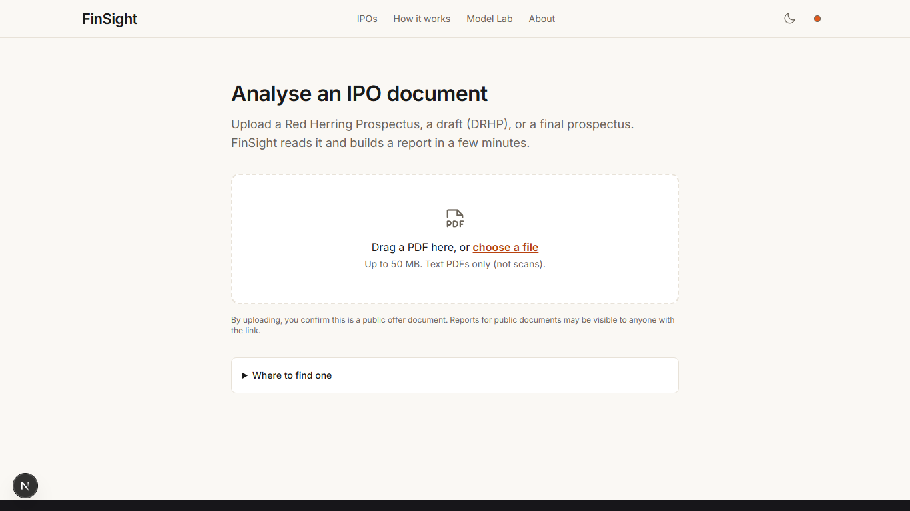
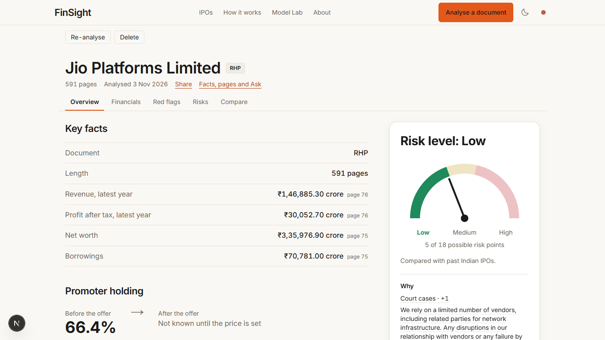
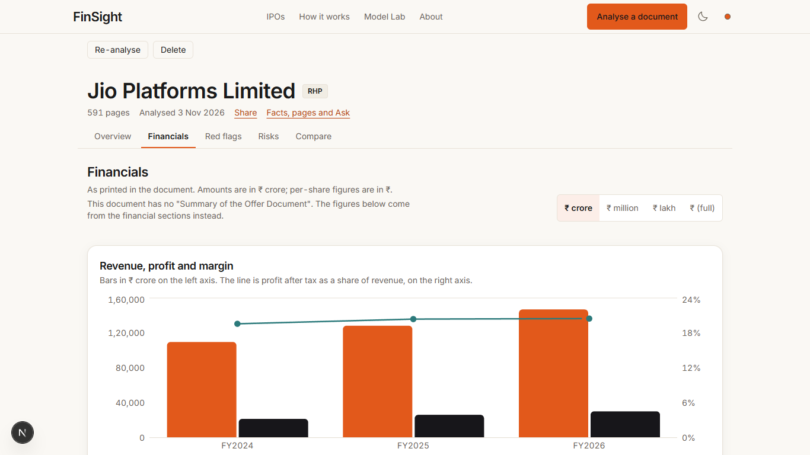
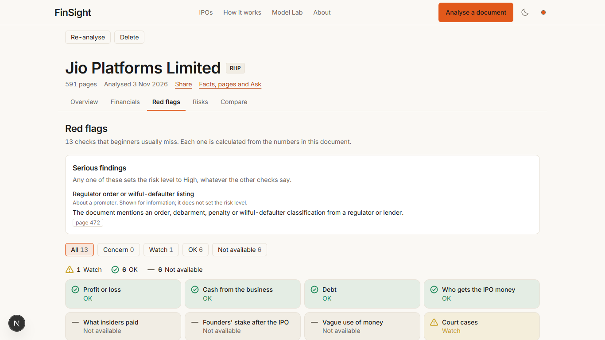
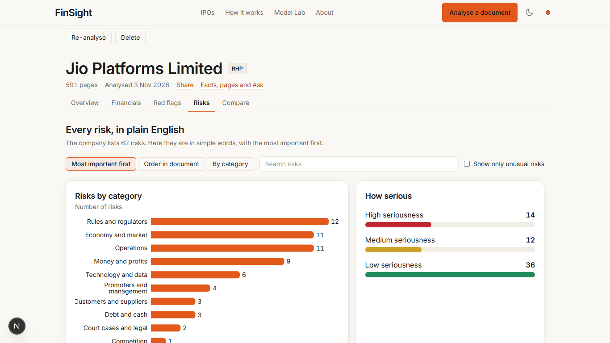
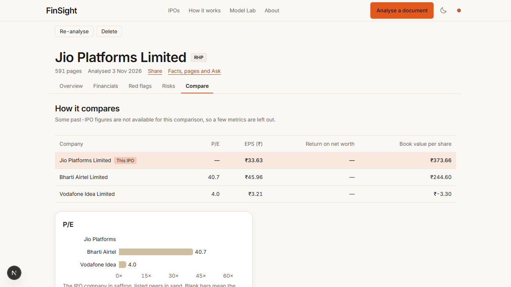

# Pages and tabs

The web app runs at <http://localhost:3000>. The screenshots are from v1.1 on the real API, with the
Jio Platforms RHP (591 pages) analysed on 3 Nov 2026.

| Page | Address | What it is for |
| --- | --- | --- |
| Home | `/` | What FinSight does, with a real RHP page under an X-ray lens |
| IPOs (library) | `/ipos` | The 10 showcase IPOs from 2025 |
| Analyse a document | `/upload` | Upload your own offer document |
| Report | `/reports/<doc_id>` | Overview, Financials, Red flags, Risks, Compare |
| Facts, pages and Ask | `/ipos/<id or doc_id>` | Facts with page citations, the PDF pages and the chat |
| My uploads | `/me/uploads` | Every document you analysed on this machine |
| How it works | `/how-it-works` | The pipeline in plain English |
| Model Lab | `/lab` | The evaluation numbers behind each model |
| About | `/about` | Who made it, data, limits, licences |

## Home

**X-ray an IPO** goes to the upload page; **See a sample report** opens a showcase report. The line
"Sign in with Google to upload" on the home page describes the hosted design; on your own machine
there is no sign-in and every upload belongs to one local user.

## IPOs (library)

Ten recent mainboard IPOs (Ather Energy, Groww, HDB Financial Services, Hexaware Technologies,
Lenskart, LG Electronics India, Meesho, PhysicsWallah, Tata Capital, Urban Company), each with its RHP
and final prospectus. The chart splits each issue into the fresh issue (money for the company) and the
offer for sale (money for selling shareholders). Pick one to open its facts, pages and chat.

## Upload

See [Your first upload](../getting-started/first-upload.md).

## Report

Every report has the company name, the document type badge (RHP, DRHP or Prospectus), the page count,
the analysis date, **Share** (copies the link), **Facts, pages and Ask**, and the **Re-analyse** and
**Delete** buttons.

### Overview

- **Key facts**: document, length, latest-year revenue, profit after tax, net worth and borrowings,
  each with its page. When the offer amounts are printed, "The offer in one line" says how much goes to
  the company and how much to selling shareholders.
- **Promoter holding** before and after the offer ("Not known until the price is set" in an RHP).
- **Risk level card**: Low / Medium / High on a gauge, the points behind it ("5 of 18 possible risk
  points"), **Why** (each reason with its points) and the disclaimer. See
  [Reading the results](reading-results.md#risk-level).
- **What the company says its strengths are**, in the company's words, marked as not checked.
- **The biggest risks** and **Red flags at a glance** (decided, not available, pending), each linking to
  its tab.

### Financials

Three fiscal years plus the stub period as printed in the document, with a unit switch (₹ crore,
million, lakh or full rupees): revenue, profit after tax and margin chart; EPS, NAV per share, PAT
margin, debt to equity and return on net worth under **Key ratios**, each with the page and, for
computed ratios, the formula. When a document has no "Summary of the Offer Document" (Jio's RHP has
none), the tab says so and the figures come from the financial chapters instead (C-ADR-27).

### Red flags

- **Serious findings**: events such as a regulator order, a going-concern doubt or a qualified audit,
  with the page. Each says whom it is about. One about the company sets the risk level to High; one
  about a promoter, director or group company is shown "for information" and does not (C-ADR-26).
- **13 checks** (profit or loss, cash from the business, debt, who gets the IPO money, what insiders
  paid, founders' stake after the IPO, vague use of money, court cases, related-party dealings,
  customer concentration, price versus listed peers, auditor's remarks, pledged promoter shares). Filter
  by Concern, Watch, OK or Not available. Each card opens the numbers used, the sentence, the pages and
  "How this check works". Thresholds: [Red-flag checks](../reference/redflags.md).

### Risks

Every risk factor of the document ("The company lists 62 risks"), sorted **Most important first**,
**Order in document** or **By category**, with a search box and **Show only unusual risks**. Charts show
risks by category and by seriousness. Each card has the category, the seriousness, an
"Unusual: in x% of past IPOs" or "Common" badge where it applies, the document's own wording and a
plain-English version. The first 15 risks are rewritten automatically; **Explain in plain English**
rewrites any other one, one at a time (12.3 s on average per risk in a CPU-only test of 60 risks, [model card](../model_cards/risk_simplifier.md#evaluation)). The number rewritten automatically is `simplify.auto_top_n` (15).

### Compare

The listed peers that the document's "Basis for Offer Price" chapter names, with P/E, EPS, return on
net worth and book value per share, and a P/E chart. The issuer row is named after the company. A blank
cell means the document does not print that value. The comparison with past IPOs appears only for
metrics with enough past values ([Compare reference](../reference/compare.md)).

## Facts, pages and Ask

The workspace has three panes: the **facts** (the X-Ray fact sheet, each value with ✅ / ⚠️ and its
page), the **document** (page images; clicking a fact or a page chip jumps to the page and highlights
the words), and **Ask** (the chat). Chat answers come from the document only, cite their pages, and
mark every number ✅ verified, ⚠️ unverifiable or ❌ contradicted. Questions asking for advice
("Should I apply?") or forecasts are declined before the model runs, and the key facts are shown
instead. The glossary drawer explains terms such as RHP, OFS and price band ([Glossary](../glossary.md)).

## My uploads

Every document analysed on this machine, with its status, so you can reopen, re-analyse or delete it.

## Model Lab

The evaluation numbers behind the product, read from `eval_results/` through `/api/lab/*`: the
extractor ladder, field accuracy, the number verifier, weak labels, retrieval, the Phase 2 models and
FinSight Bench. The full list with sources is on [Results and experiments](../evaluation.md).
